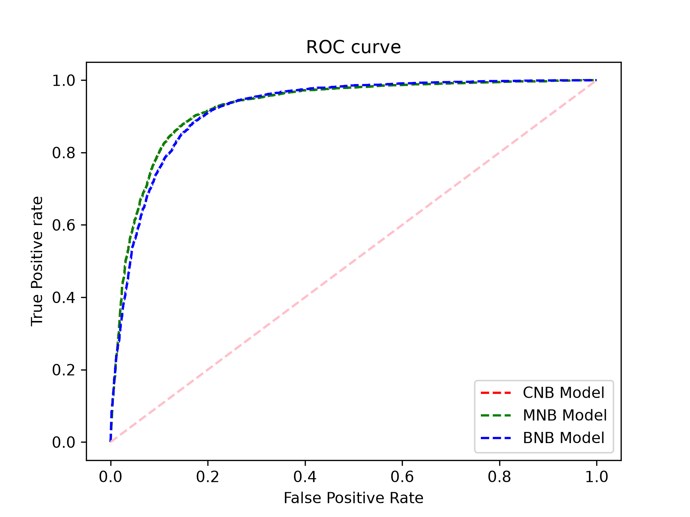

# Movie Review Sentiment Analysis (IMDB Dataset)

Dự án phân tích cảm xúc (Sentiment Analysis) trên tập dữ liệu **IMDB Movie Reviews** (50,000 đánh giá) sử dụng các mô hình **Naive Bayes** và kỹ thuật xử lý ngôn ngữ tự nhiên (NLP). Dự án đi kèm notebook phân tích chuyên sâu và giao diện web demo trực quan để kiểm thử bất kỳ câu đánh giá nào theo thời gian thực.



---

## 📁 Cấu trúc thư mục (Repository Structure)

```text
masterDS-NLP/
├── artifacts/              # File mô hình đã huấn luyện (model.joblib)
├── data/                   # Dữ liệu phục vụ huấn luyện (IMDB Dataset.csv)
├── demo/                   # Ứng dụng web demo
│   ├── static/             # Giao diện frontend (HTML, CSS, Vanilla JS)
│   │   ├── app.js
│   │   ├── index.html
│   │   └── style.css
│   └── app.py              # Backend HTTP server (Python native + scikit-learn)
├── docs/                   # Tài liệu & hình ảnh minh họa (ROC.png)
├── notebooks/              # Jupyter Notebook nghiên cứu & huấn luyện chi tiết
│   └── sentimental-analysis-using-naive-bayes-classifier.ipynb
├── src/                    # Mã nguồn cốt lõi (Module tiền xử lý & train)
│   ├── __init__.py
│   ├── preprocessing.py    # Hàm chuẩn hóa và làm sạch văn bản
│   └── train.py            # Script huấn luyện và đóng gói mô hình
├── .gitignore              # Bỏ qua virtualenv, checkpoints, dữ liệu nặng
├── README.md               # Tài liệu hướng dẫn sử dụng
└── requirements.txt        # Danh sách thư viện phụ thuộc
```

---

## 🚀 Hướng dẫn cài đặt & Khởi chạy

### 1. Yêu cầu hệ thống
- Python `>= 3.10`
- Khuyến nghị sử dụng [uv](https://github.com/astral-sh/uv) hoặc `python3 -m venv` để quản lý môi trường ảo.

### 2. Cài đặt môi trường ảo & Thư viện

```bash
# Tạo môi trường ảo
python3 -m venv .venv
source .venv/bin/activate

# Cài đặt các thư viện cần thiết
pip install -r requirements.txt
```
*(Nếu sử dụng `uv`: `uv venv && uv pip install -r requirements.txt`)*

### 3. Huấn luyện mô hình (Optional / Huấn luyện lại)

Mô hình TF-IDF (1-2 gram) kết hợp Multinomial Naive Bayes đạt độ chính xác **~89.3%** trên tập test:

```bash
python src/train.py
```
*Kết quả mô hình sẽ được lưu vào `artifacts/model.joblib` để nạp tức thì trong tương lai.*

### 4. Khởi chạy Giao diện Web Demo

Chạy web server cục bộ (chỉ lắng nghe an toàn tại `localhost`):

```bash
python demo/app.py
```

Sau khi terminal hiển thị:
```text
Open http://127.0.0.1:8000
```
Mở trình duyệt và truy cập: **`http://127.0.0.1:8000`**

---

## 🔍 Tính năng của Giao diện Demo

1. **Phân loại cảm xúc tức thì:** Nhập bất kỳ câu đánh giá nào bằng tiếng Anh (hoặc click chọn các câu ví dụ mẫu).
2. **Xác suất phân bố:** Hiển thị trực quan thanh tỉ lệ phần trăm xác suất giữa **Positive** và **Negative**.
3. **Giải thích đặc trưng (Explainability):** Bóc tách các từ / cụm từ có trọng số đóng góp lớn nhất thúc đẩy mô hình dự đoán là tích cực hay tiêu cực.
4. **Văn bản sau tiền xử lý:** Cho phép xem đoạn text thực tế sau khi qua bước chuẩn hóa (loại bỏ HTML, ký tự đặc biệt, xử lý từ phủ định).

---

## 📓 Jupyter Notebook

Để theo dõi toàn bộ quy trình EDA, so sánh giữa các biến thể Naive Bayes (`MultinomialNB`, `BernoulliNB`, `ComplementNB`) và vẽ biểu đồ ROC curve:

```bash
jupyter notebook notebooks/sentimental-analysis-using-naive-bayes-classifier.ipynb
```
